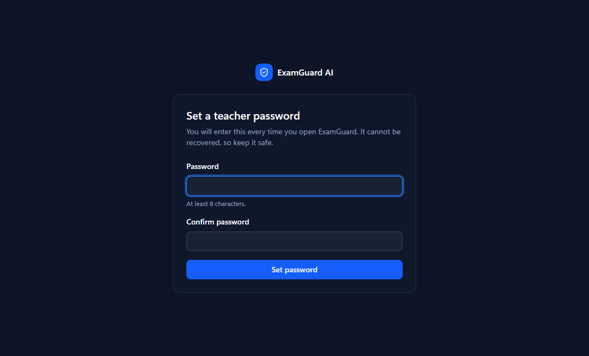
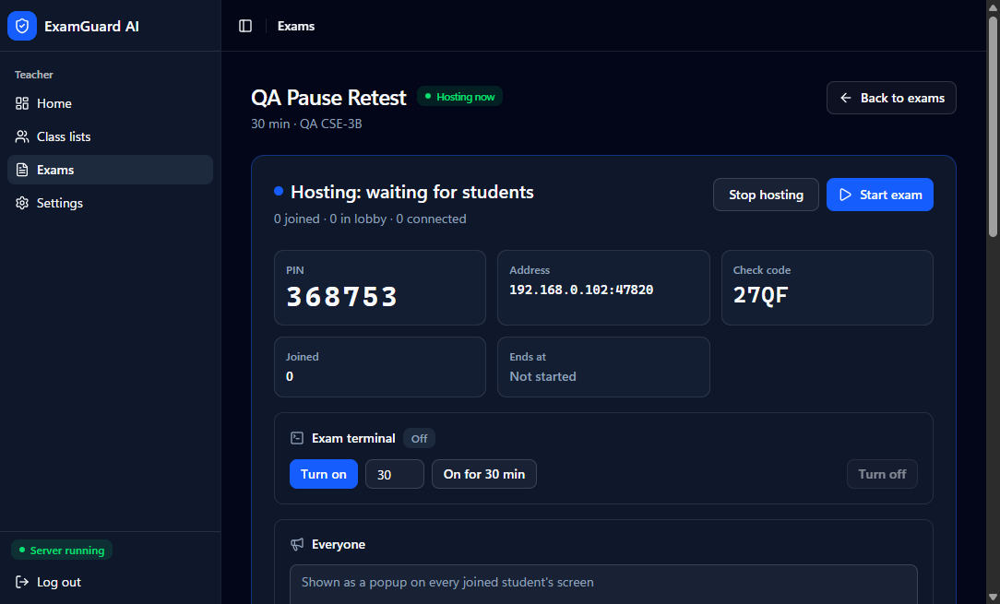
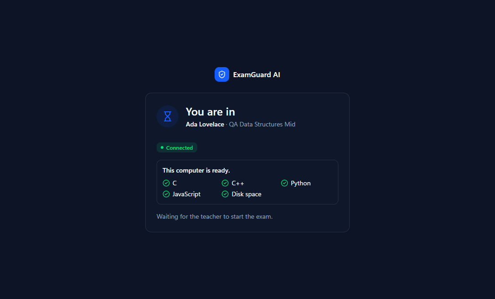
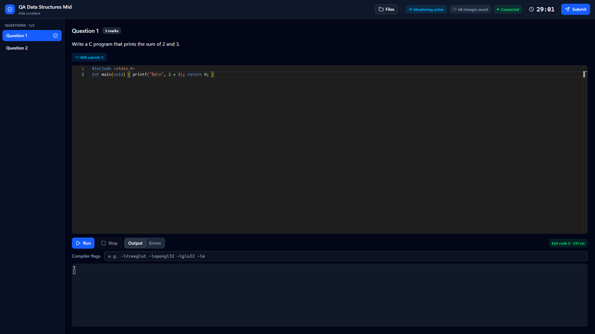
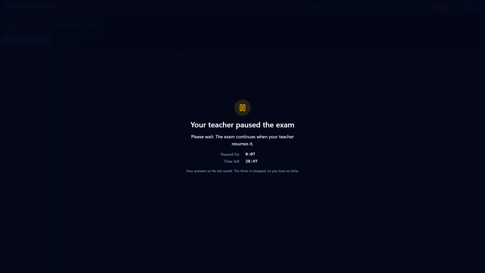
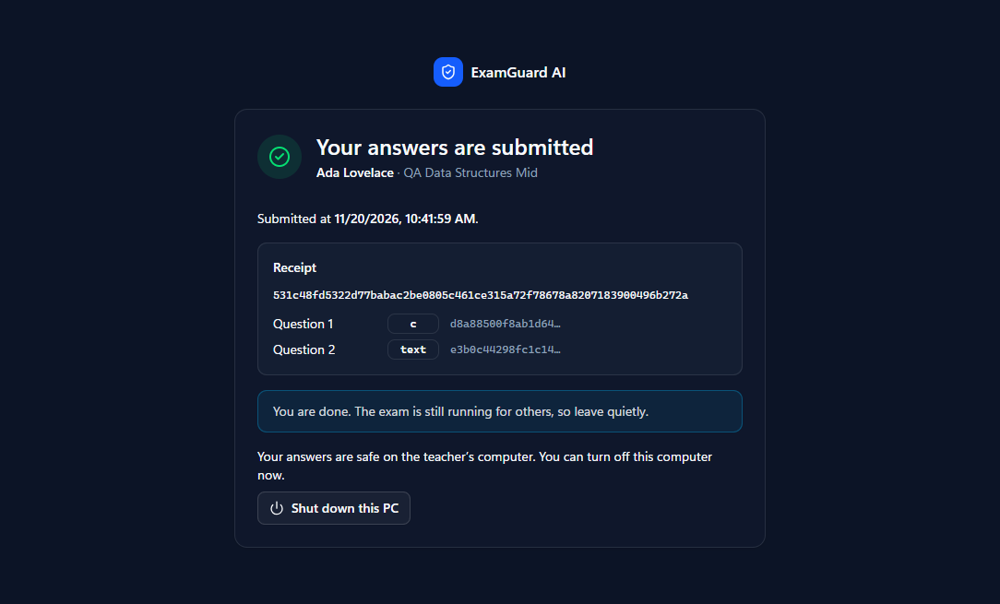
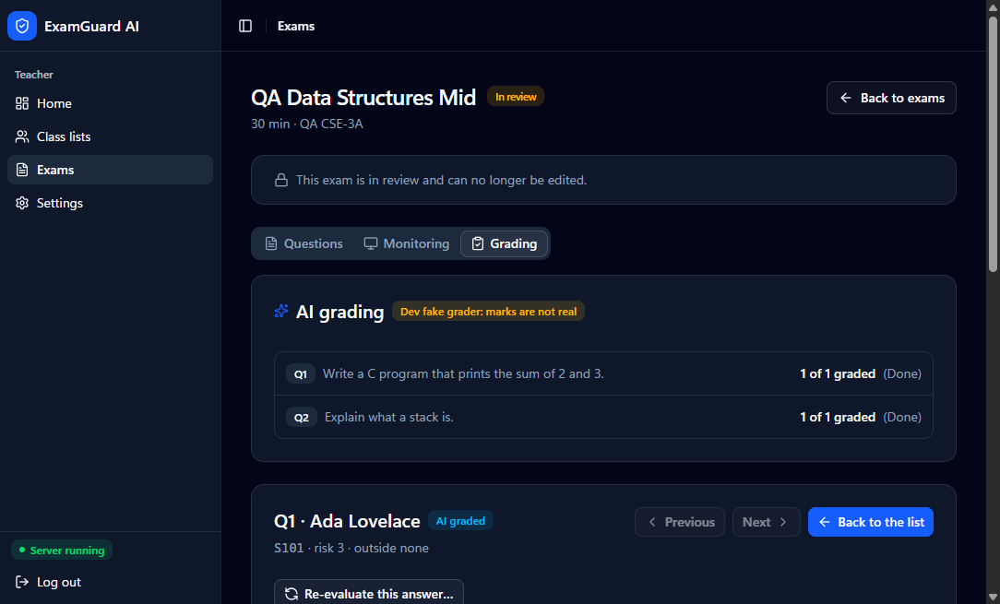
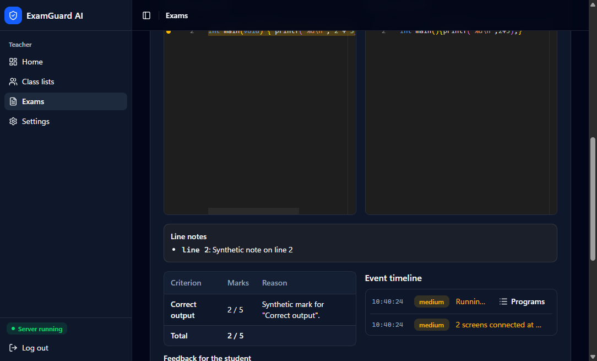

# ExamGuard AI: Project Guide

**A Windows desktop platform for running, monitoring and AI-grading programming exams in a university computer lab.**

Version 0.3.0 · Protocol 5 · November 2026

This guide explains the finished project in layers: first what the application does and how a teacher and students use it, then how it is built (architecture, technology, code). It is written so the project can be presented to someone who has not seen the code before.

---

## Contents

1. [The problem and the idea](#1-the-problem-and-the-idea)
2. [The two applications](#2-the-two-applications)
3. [One exam from start to finish](#3-one-exam-from-start-to-finish)
4. [Feature list](#4-feature-list)
5. [Architecture](#5-architecture)
6. [Technology stack](#6-technology-stack)
7. [A tour of the code](#7-a-tour-of-the-code)
8. [How the important flows work in code](#8-how-the-important-flows-work-in-code)
9. [Data model](#9-data-model)
10. [Security and privacy](#10-security-and-privacy)
11. [Reliability: no lost work](#11-reliability-no-lost-work)
12. [Testing and quality](#12-testing-and-quality)
13. [Running, building and installing](#13-running-building-and-installing)
14. [Limitations and future work](#14-limitations-and-future-work)
15. [Glossary](#15-glossary)

---

## 1. The problem and the idea

Programming exams in a computer lab have three hard parts:

- **Running them.** 100–200 students, each needing an editor, compilers, and a way to hand in code that cannot be lost when a PC crashes or the network drops.
- **Supervising them.** Every lab PC has internet. Students can open ChatGPT, a messenger or a USB stick, and one invigilator cannot watch 200 screens.
- **Grading them.** Reading hundreds of programs by hand takes days.

**ExamGuard AI** handles all three from one application on the teacher's own PC. There is no cloud server: the teacher's computer hosts the exam over the lab's local network.

**The key design decision is "monitor, record and alert", not "block".** ExamGuard never controls the student PC. It does not block websites, close apps or turn off the internet (students need the internet to install packages). Instead, everything a student does outside the exam window is recorded with screenshots and shown live to the teacher: which program, which window title, which website in Chrome or Edge. The evidence is the deterrent. The teacher always makes the final decision.

**AI assists, the teacher decides.** After the exam, an AI model (Google Gemini) grades every answer against the teacher's sample answer and marking criteria. The teacher reviews every grade, can edit or re-evaluate it, and only then finalizes and exports the marks. The AI only ever sees an anonymous id, never a student's name or ID.

---

## 2. The two applications

One codebase builds two separate Windows apps:

| | **ExamGuard Teacher** | **ExamGuard Student** |
|---|---|---|
| Installed on | The teacher's PC | Every lab PC |
| Purpose | Create exams, host them, watch students live, grade with AI, export marks | Join an exam, write and run code, submit; monitors the PC while the exam runs |
| Runs | The exam **server** (inside the app) and the database | A fullscreen exam window, the code runner, the monitor |
| Login | Teacher password | Student ID + 6-digit exam PIN |
| Installer size | about 110 MB (419 MB installed) | about 204 MB (about 1.1 GB installed, with C/C++, Python and Node toolchains) |

A student never installs anything for an exam: lab IT installs ExamGuard Student once, with compilers included, so code runs offline.

---

## 3. One exam from start to finish

The screenshots below come from a real run of the apps on one PC (teacher and student side by side) on 2026-11-20.

### 3.1 Teacher: set up

On first start the teacher sets a password. Every later start asks for it.



The teacher then:
1. **Imports a class list** (a CSV of student IDs and names, e.g. an Excel export).
2. **Creates an exam:** title, duration, class list, and settings (monitoring rules, run limits, a list of "high-severity" programs and websites such as `chatgpt.com`).
3. **Adds questions.** A *code* question has allowed languages (C, C++, Python, JavaScript), a sample answer and marking criteria (e.g. "Correct output: 5 marks"). A *written* question has a sample answer and criteria. Files (data sets, header files) can be attached.
4. Marks the exam **Ready** (ExamGuard checks that every question is complete) and presses **Host**.

### 3.2 Teacher: hosting

Hosting starts the student listener on the LAN, announces the exam on the network (mDNS), and shows a **PIN**, the **address** and a 4-character **check code**.



### 3.3 Student: join

The Student app finds the exam on the network by itself (or the student types the address). The student checks that the **check code** matches the teacher's screen. This proves they are talking to the real teacher PC: the code is computed from the server's TLS certificate. Then they enter their student ID and the PIN, confirm their name, and read and accept the **monitoring notice**, which says exactly what is recorded.

In the lobby the app tests the PC: it compiles and runs a tiny program in every language and checks free disk space. The teacher sees "N of M ready" before starting.



### 3.4 Student: the exam

When the teacher presses **Start exam**, every student gets the questions and the same end time. The exam window has:
- a question list, the question text and marks
- **Monaco** (the editor from VS Code) for code answers, a text box for written ones
- **Run**: compiles and runs the program locally, with an interactive console
- an optional **terminal** the teacher can switch on (to `pip install` / `npm install` packages) and an optional **Files** panel
- status chips: *Monitoring active*, *All changes saved*, *Connected*, and the server-synchronised **timer**



Answers are **autosaved** every 10 seconds and on every Run, question switch or language switch, both to the teacher's server and to an encrypted local file.

### 3.5 Teacher: live monitoring and actions

While the exam runs the teacher sees:
- a **roster**: status, connected or offline, risk score, time spent outside the exam, "Not monitored" and "2 screens" flags
- a **grid of live thumbnails** of student screens and a **live view** (WebRTC video) of any one student
- an **alert feed**: switching to another app, a website in Chrome/Edge (e.g. `chatgpt.com`, high severity), a private browser window, Task Manager, a second monitor, the lock screen, a paste from outside the exam, typing too fast to be human (pasted from elsewhere), all with screenshots
- a **timeline per student**

Teacher actions: message or warn one student or everyone, **lock** a student's screen, give **extra time** (one student or everyone), turn the **terminal** on (for N minutes), **pause** the whole exam, add a question or file mid-exam, end the exam.

When paused, every student sees this screen. The timer stops, and the paused time is given back on resume:



### 3.6 Student: submit

Pressing **Submit** sends every unsaved change, then asks the server to make the answers final. The student gets a **receipt**: a SHA-256 hash of all answers, so neither side can later claim different answers were handed in. At the deadline (plus a grace period) the server auto-submits everyone still working.



### 3.7 Teacher: AI grading, review, results

After the exam ends the teacher presses **Evaluate with AI**. Each answer is graded per criterion, with a reason, line notes, feedback and a confidence level.



In **Review** the teacher sees the student's answer next to the sample answer, the AI's marks and the student's event timeline. They can **Accept**, **Edit marks**, or **Re-evaluate** with an extra instruction (for one answer or a whole question). Every change is kept in a history.



Finally **Finalize marks** (a backup is taken first, and marks are then locked) and **Export CSV**: one row per student with marks per question, total, event counts by severity and minutes outside the exam.

---

## 4. Feature list

### Exam management (teacher)
- Class lists from CSV (quotes, BOM and Excel exports handled)
- Exams with duration, grace period, run limits (time, output size), monitoring policy, high-severity apps/sites
- Code questions (C, C++, Python, JavaScript; several languages per question) and written questions, with marking criteria in half-mark steps
- Attached exam files, copied into each student's project folder at start
- Practice exams (nothing monitored or graded)
- States: Draft → Ready → Hosting → Running → Ended → Grading → In review → Finalized

### Student exam client
- Automatic discovery (mDNS) or typed address, with a certificate check code
- Join with student ID + PIN; same-PC rejoin without the PIN after a restart
- Monaco editor, one buffer per language; local **Run** with an interactive console (xterm.js + ConPTY)
- Teacher-controlled terminal (PowerShell) with `pip`, `npm` and `pacman`, logged
- Files panel (project folder explorer)
- Lobby readiness self-test; pause overlay; lock overlay; teacher messages
- Receipt; optional "Shut down this PC" after submitting

### Monitoring (inside the student app, read-only)
- The window in front every second, the programs with a window every 2 s
- Website address in Chrome and Edge (UI Automation), private windows detected
- Screenshots on a switch, on a title change, and every 20 s while outside
- App launches, Task Manager, extra monitors, lock screen / Ctrl+Alt+Del
- Paste guard: only text copied inside the exam can be pasted
- Large-insertion detection (typing faster than a person)
- Watchdog: if the monitor itself stops working, the teacher is told (`monitor_stalled`)
- Severity classification (low / medium / high / critical) and a running risk score per student

### Live supervision
- Roster table (TanStack Table, 200 rows), thumbnail grid (every 4 s, 320 px), live view (WebRTC, about 8 fps)
- Alerts as they happen, audit log of every teacher action

### AI grading
- Gemini with structured JSON output, validated (marks ≤ max, half steps, criteria names match, total = sum)
- Retries with backoff, repair hints for invalid replies, `needs manual` after that
- Anonymous ids only; key stored encrypted on the teacher PC
- Re-evaluation with a teacher instruction; full grade history; finalize with backup; CSV export

### Reliability
- No work lost on app crash, network drop, power loss or server restart (see section 11)
- Tested with 200 simulated students for 30 minutes

---

## 5. Architecture

### 5.1 The big picture

```
                         TEACHER PC                                              LAB PCs (x200)
 ┌──────────────────────────────────────────────────────────┐        ┌────────────────────────────────────┐
 │  ExamGuard Teacher (Electron)                            │        │  ExamGuard Student (Electron)      │
 │                                                          │        │                                    │
 │  Renderer (React UI) ──HTTP/WS loopback──┐               │        │  Renderer (React UI, Monaco)       │
 │        ▲ preload (IPC)                   │               │        │        ▲ preload (IPC)             │
 │  Main process ── starts/restarts ──▶ Server             │  LAN   │  Main process                      │
 │  (window, login, safeStorage)      (utilityProcess)      │◀══════▶│   • session client (WSS)           │
 │                                     • Express 5 + ws     │ HTTPS  │   • monitor (get-windows,          │
 │                                     • SQLite (WAL)       │  WSS   │     SiteReader.exe, screenshots)   │
 │                                     • mDNS advert        │ WebRTC │   • code runner + terminal (pty)   │
 │                                     • grading → Gemini ──┼──▶ Internet  • offline queue (encrypted)   │
 └──────────────────────────────────────────────────────────┘        └────────────────────────────────────┘
```

- **Electron** gives each app three kinds of process: the **main** process (Node.js, full OS access), the **renderer** (the web page, React UI) and a **preload** script that bridges the two through a small, typed API (`window.examguard`). The renderer never touches Node directly (`contextIsolation`, `sandbox`, no `nodeIntegration`).
- In the Teacher app, the **exam server** runs in a separate Electron `utilityProcess`. If it crashes, main restarts it in about a second, and because all state is in SQLite nothing is lost.
- The server has **two listeners**: the teacher listener on `127.0.0.1:47821` (loopback only, never on the network, protected by a random per-launch token and the teacher login) and the student listener on port `47820` (HTTPS/WSS, only while an exam is hosted).

### 5.2 Networking and protocol

| Channel | What travels |
|---|---|
| mDNS `_examguard._tcp` | The exam title, protocol version and certificate fingerprint, so students find the exam automatically |
| HTTPS (student) | Join, confirm, exam file downloads, answer restore |
| WSS (student, one socket each) | `hello`/`welcome`, ping/pong (clock), answer saves, events, screenshots (binary chunks), thumbnails, Submit, teacher messages, state pushes, WebRTC signaling |
| HTTP + WS (teacher, loopback) | The whole teacher API and live roster, alerts, thumbnails, grading progress |
| WebRTC (LAN only) | The teacher's live view of one student's screen |

Every message, in both directions, has a **Zod schema** in `packages/shared`. Both the server and the apps validate with the same schema, so a type mismatch cannot slip through. The protocol has a version (`major 5`): apps with a different major version refuse each other with a clear message.

**TLS without a certificate authority:** the teacher app makes its own self-signed certificate. Students **pin** it: via mDNS the fingerprint must match the announced one, and via a typed address the student compares the 4-character check code with the teacher's screen. The fingerprint is checked before a single byte (or the PIN) is sent.

### 5.3 Server internals: a layered design

A request passes:

```
routes/*.routes.ts → middlewares/ → controllers/*.controller.ts → services/<domain>/ → db/repositories/*.repo.ts → SQLite
```

- **Routes** only connect paths to middlewares and controllers.
- **Middlewares:** CORS, teacher token, login required, student session, body parsing, and one error handler that always answers `{ error: { code, message, details? } }`.
- **Controllers** validate input with Zod and call services; they refuse with `throw new ApiError(status, code, message)`.
- **Services** hold all business logic (hosting, join, deadlines, answers, submissions, events, grading, results).
- **Repositories** hold all SQL. The server is the only process that writes the database.
- **Sockets** (`sockets/`) handle the two WebSocket servers and the `SessionHub`, which tracks who is connected and pushes roster updates to the teacher in batches.

### 5.4 Time

The **server's clock is the only authority** for timers and deadlines. Each student app estimates the server's clock from ping/pong round trips, anchored on a monotonic clock so a change of the PC's clock cannot shift the timer. A deadline is:

```
deadline = started_at + duration + global extra time + personal extra time + total paused time
```

A pause is a flag plus a running total: every deadline moves by the pause, so students lose no time.

---

## 6. Technology stack

| Area | Technology | Why it was chosen |
|---|---|---|
| Language | **TypeScript** (strict, no `any`) everywhere | One language for UI, server and tools; types catch errors early |
| Desktop shell | **Electron 44** + **electron-vite** | Windows desktop app with web UI; access to native APIs (screen capture, processes) |
| UI | **React 18**, **Tailwind CSS**, **shadcn/ui** (Radix primitives), lucide icons | Modern, accessible components; light and dark themes |
| UI state and tables | **Zustand**, **TanStack Table/Query** | Small state stores; fast tables for 200-row rosters |
| Code editor | **Monaco** (`@monaco-editor/react`, local workers) | The VS Code editor, working offline |
| Terminal | **node-pty** (Windows ConPTY) + **xterm.js** | A real interactive console and PowerShell |
| Server | **Node.js**, **Express 5**, **ws** | Simple layered HTTP API plus WebSockets on the same port |
| Database | **SQLite** via **better-sqlite3** (WAL mode) | No database server to install; fast, transactional, one file |
| Validation | **Zod** (shared package) | One schema per message, used by both sides; types are derived from it |
| Discovery | **bonjour-service** (mDNS) | Students find the exam without typing an IP |
| TLS | **selfsigned** (node-forge) | Certificates without OpenSSL |
| Monitoring | **get-windows** (native), **SiteReader.exe** (C#, UI Automation), Electron `desktopCapturer`/`screen`/`powerMonitor`, **tldts** | Window in front, browser address, screenshots, registrable domain |
| Live view | **WebRTC** (LAN host candidates only) | Real-time video without any server or internet |
| AI | **@google/genai** (Gemini 2.5 Flash by default), JSON-schema output | Structured, validated grading |
| CSV | **papaparse** | Robust class list import |
| Toolchains (student) | WinLibs **MinGW** (C/C++), **CPython** + pip, **Node/npm**, **MSYS2 pacman** | Code runs locally and offline |
| Monorepo | **pnpm workspaces** + **Turborepo** | Several packages, one install, cached builds in dependency order |
| Tests | **Vitest**, **supertest** | Fast unit, integration and socket tests |
| Quality | **ESLint** (typescript-eslint), **Prettier** | Consistent, checked code |
| Installer | **electron-builder** (NSIS) | Windows installers with firewall rules and clean uninstall |

---

## 7. A tour of the code

### 7.1 Repository layout

```
exam-gaurd/
├─ apps/
│  ├─ desktop/          Both Electron apps (Teacher and Student) from one codebase
│  └─ server/           The exam server (runs inside the Teacher app)
├─ packages/
│  └─ shared/           Zod schemas + types for every API and WebSocket message
├─ tools/
│  └─ student-sim/      Simulates up to 200 students against a real server (load test)
├─ scripts/             fetch-toolchains, package-desktop (installers)
├─ docs/                Requirements, architecture, protocol, data model, decisions, this guide
└─ requirements.md      The source of truth for what the product must do
```

Size (code without tests): server about 11,200 lines, desktop main about 7,400, renderer about 15,100, shared about 2,900, simulator about 1,800, so roughly 38,000 lines of TypeScript, plus about 190 test files.

### 7.2 `packages/shared`: the contract

`src/protocol/` holds one file per topic (`join.ts`, `ws.ts`, `submission.ts`, `monitoring.ts`, `readiness.ts`, `exam-files.ts`, `protocol-version.ts`, …). Each exports a Zod schema and the TypeScript type inferred from it. `src/app/` holds logic shared by apps (e.g. `session-exit.ts`, the rule for when an offline student's exam is over).

### 7.3 `apps/server/src`: the exam server

```
server.ts            Entry point inside the utilityProcess
container.ts         Builds every repository and service once (simple dependency injection)
app.ts, studentApp.ts  The teacher (HTTP) and student (HTTPS) Express apps
routes/              One Router per resource (exams, questions, hosting, grading, results, …)
middlewares/         cors, teacherToken, requireLogin, studentAuth, body, error
controllers/         Validate with Zod, call services, refuse with ApiError
services/
  hosting/           HostingManager (start/stop/start exam/end), DeadlineWatcher,
                     GlobalActions (pause, extra time, broadcast), TerminalSwitch, StudentLock
  join/              JoinService (PIN, student code, device id, tokens), JoinLimiter
  exams/             exam state machine, ready checks, deadlines (StudentDeadlines)
  answers/           answer intake rules, AnswerWriter (batched commits)
  submissions/       SubmissionService: submit, auto-submit, end → final answers + receipt
  events/            classify.ts (severity), risk.ts (score), EventRecorder
  screenshots/       EvidenceIntake (reassembles screenshot chunks), retention
  grading/           grading-service, grade-answer, prompt, validate, providers (gemini, fake, synthetic)
  results/           finalize, backup, CSV export
sockets/             student.socket.ts, teacher.socket.ts, SessionHub, ThumbRelay, LiveRelay, rateLimit
db/                  connectDb.ts, migrations/0001…0018 (*.sql), repositories/*.repo.ts
utils/               ApiError, TLS certificate, ids (UUIDv7), PIN
testing/             inject() for route tests, LiveExam and RestartableExam for socket tests
```

### 7.4 `apps/desktop/src`: the two apps

```
main/                Node side (one folder per feature)
  index.ts             Entry: profile, single instance, creates the window, starts the app
  teacher/startTeacher.ts   Teacher: starts the server (server/serverHost.ts), settings, exports
  student/startStudent.ts   Student: wires discovery, join, session, monitor, runner, terminal …
  join/                mDNS discovery, probeHost (certificate pinning), JoinClient
  session/             SessionClient: the student's WSS link, reconnects, clock, Submit
  answers/             AnswerOutbox: numbers saves, keeps them until acked
  resume/              OfflineQueue (encrypted, atomic), SessionStore, restore after restart
  tracking/            The monitor: Tracker, SwitchPolicy, inside check, site reader, watchdog
  screenshots/, thumbs/, live/   Screen capture, grid thumbnails, WebRTC capture window
  runner/              CodeRunner: compile and run C/C++/Python/JS with limits, tree kill
  terminal/            TerminalHost (PowerShell in a pty), transcript, install detection
  examFiles/, files/   Exam file download and the Files panel (paths kept inside the workspace)
  clipboard/           Clipboard clearing for the paste guard
  window/              Main window, exam lock (fullscreen, cannot close while working)
  utils/               tlsPin (certificate pinning), paths, atomicWrite, withTimeout
preload/             api.ts: the typed window.examguard API; exposes only the app's own methods
shared/ipcChannels.ts  Names of every IPC channel
renderer/src/        React app
  App.tsx              Picks TeacherGate or StudentFlow (the other app's code is not bundled)
  pages/               Whole screens: teacher (exams, exam detail, settings…), student (find, join,
                       lobby, exam, receipt…)
  components/          ui/ (shadcn), common/, teacher/ (roster, grid, hosting panel, review…),
                       student/ (exam header, timer, editors, overlays…)
  hooks/               useAutosave, usePasteGuard, useInsertionWatch, useTick, useSessionExit …
  store/               Zustand stores (answers, …)
  api/                 Teacher API clients (one per resource)
  lib/                 Pure logic (clock, autosave, roster table, audit text, …), unit-tested
```

**How one codebase becomes two apps:** `electron-vite --mode teacher|student` defines a compile-time constant `__EG_APP__`. The code branches on it (`if (__EG_APP__ === 'teacher') …`) with dynamic imports, so the bundler drops the other app's code completely. The Student app does not contain the server or the database; the Teacher app does not contain the monitor or the compilers.

---

## 8. How the important flows work in code

### 8.1 Joining an exam
1. `join/discovery.ts` browses mDNS and lists hosts with their check code.
2. `join/probeHost.ts` opens TLS to the host and computes the **fingerprint** of the certificate before sending anything (`utils/tlsPin.ts`). The check code shown is computed from that certificate.
3. `JoinClient.join()` sends `POST /api/v1/join` with student ID, PIN, a device id and the monitor's self-check. On the server, `JoinService` checks the PIN, finds the student in the class list, enforces "one PC per student" and rate limits, and returns a session token. The student is `not_joined` until they accept the notice (`POST /join/confirm` → `lobby`).
4. `SessionClient.start()` opens the WSS socket and says `hello` with the token; the server answers `welcome` with the full exam state.

### 8.2 Autosave
1. The renderer's `Autosaver` (`lib/autosave.ts`, `hooks/useAutosave.ts`) collects changed editor buffers every 10 s and on Run or a switch, and calls `window.examguard.saveAnswer()`.
2. In main, `AnswerOutbox` gives each save a number (`clientSeq`) and a server-time stamp, keeps it until acked, and appends it to the **encrypted offline queue**.
3. The server's `answer-intake.ts` checks the rules (exam running, student working, made before the deadline, arrived within the grace, allowed language) and hands it to `AnswerWriter`, which commits saves in batches (250 ms or 200 rows). Only after the commit does it send `answer.ack`.
4. On ack, main removes the save from memory and from the queue. Anything unacked is sent again after every reconnect; the server keeps each `clientSeq` once, so nothing is stored twice.

### 8.3 Monitoring a switch to a browser
1. `tracking/tracker.ts` reads the window in front every second (`get-windows`).
2. `inside.ts` decides inside/outside (the app itself, the student's own running program by pid, the bundled toolchains).
3. For Chrome/Edge, `site.ts` runs `SiteReader.exe <window>` to read the address bar → `{domain, url}` or `private`.
4. `policy.ts` (`SwitchPolicy`) turns observations into evidence: `focus_lost`, `title_changed`, `still_outside` every 20 s, `focus_returned` with the time away, and asks for a screenshot.
5. `SessionClient.sendEvidence()` sends the screenshot as binary chunks and then the event. The server's `EvidenceIntake` reassembles the picture and saves it, `classify.ts` gives a severity (e.g. a site on the teacher's list → high), `risk.ts` adds points, and `SessionHub` pushes an **alert** to the teacher at once.

### 8.4 Submit and the receipt
1. The renderer saves everything (`saveNow('submit')`), then calls `submitExam()`.
2. `SessionClient.submit()` sends `submit` after the unsent saves on the same ordered socket. If offline, it waits and sends it after reconnecting; during a pause the server refuses it and the app sends it again on resume.
3. `SubmissionService.finalize()` in one database transaction: flush pending saves, take the newest version of each answer, write `final_answers`, compute the **receipt** hash, set the student `submitted`. The same function is used for the deadline auto-submit and for "End exam", so the rules cannot drift apart.

### 8.5 AI grading
1. `grading-service.ts` creates one job per question and runs them; inside a job a small pool grades up to 4 answers at a time.
2. `grade-answer.ts` builds the input with `input.ts` (anonymous id, question, sample answer, criteria, the answer), calls the provider (`providers/gemini.ts`), and validates the JSON with `validate.ts`. It retries on rate limits and server errors and asks for a repair on an invalid reply.
3. Every attempt is stored in `evaluations` (an append-only history); the current grade is in `answer_grades`. Progress is pushed live to the teacher.

---

## 9. Data model

SQLite, one file per teacher installation, created and upgraded by numbered SQL migrations (`0001` … `0018`). Main tables:

| Table | Holds |
|---|---|
| `teacher`, `settings` | The password hash; app settings (port, run limits, AI model, retention) |
| `class_lists`, `class_students` | Imported classes and students |
| `exams` | Exam settings, state, PIN, start time, extensions, pause (`paused_at`, `paused_ms`) |
| `questions`, `marking_criteria` | Questions and their criteria (marks stored as **half-units**, e.g. 2.5 → 5) |
| `exam_students` | One row per student per exam: the session (state, token hash, device, extra time, risk score) |
| `exam_files` | Attached files (bytes on disk) |
| `answer_versions` | **Every** autosave |
| `final_answers` | The submitted answers (immutable) |
| `events` | Every monitoring/app/server event with severity and screenshot path |
| `teacher_actions` | Audit log of every teacher action |
| `terminal_chunks` | Exam terminal transcripts |
| `grading_jobs`, `evaluations`, `answer_grades` | AI grading queue, full grade history, current grade per answer |

The data folder also holds the TLS certificate, screenshots, exam files, backups and CSV exports. It can be moved to another drive from Settings.

---

## 10. Security and privacy

- **Teacher API** only on `127.0.0.1`, with a random per-launch token **and** a teacher login (scrypt password hash, lockout after failed attempts). Logging out closes the live sockets.
- **Students** are authenticated by a session token (only its hash is stored) bound to one PC; a second PC is refused and logged as critical.
- **TLS pinning** protects the PIN and answers from a fake "teacher" on the network.
- **Validation everywhere:** every HTTP body and WebSocket frame is checked against a Zod schema; frames are limited to 512 KB; events and transcripts are rate-limited per student; failed joins are rate-limited per address.
- **Electron hardening:** context isolation, sandboxed renderer, no Node in the page, a strict Content Security Policy, deny-by-default permissions, DevTools off in packaged builds, Electron fuses (no `--inspect`, asar integrity), and no external links from the student app.
- **Paths:** file names from the network never become file paths without checks (exam files, Files panel).
- **Secrets:** the Gemini key is encrypted with Windows DPAPI (`safeStorage`), given to the server only in memory during grading, never logged or stored in the database. The AI never receives names or student IDs.
- **Transparency:** students see and must accept a notice listing exactly what is recorded; the app records only during a running exam.

---

## 11. Reliability: no lost work

| What happens | What protects the work |
|---|---|
| Network drops | Saves, events and Submit wait in memory and in the encrypted offline queue; sent again on reconnect; the server deduplicates |
| Student app crashes / PC loses power | The queue file is written atomically (temp file + fsync + rename) and synced within 250 ms; on restart the app rejoins without the PIN and restores the editors from the server's copy and the queue (newest wins) |
| Server process crashes | Main restarts it; all state is in SQLite (WAL); listeners reopen with the same PIN and certificate; students reconnect by themselves |
| Server down past the deadline | After a restart the exam waits 60 s for the apps to reconnect and send queued work made in time, then auto-submits |
| Teacher pauses | Deadlines and the terminal's timer move by the pause |
| Errors in one message | Socket handlers and timers catch errors; one bad frame never takes the server down |
| Monitor hangs (a Windows call) | Timeouts, plus a watchdog that reports `monitor_stalled` |

---

## 12. Testing and quality

- **Automated tests (Vitest):** about 1,300 tests in total, run with `pnpm test`.
  - **Shared:** 194, covering the schemas and shared rules.
  - **Server:** 430, including route tests through supertest, real socket tests with a live server, and crash/restart recovery tests.
  - **Desktop:** 638, covering main-process logic, the monitor and the runner with fakes and real compilers, plus the renderer's pure logic.
  - **Simulator:** 38.
- **Load test:** `tools/student-sim` runs 200 fake students against a real server (joins, autosave, events with screenshots, disconnects, submits). Measured: 200 joined in 6.3 s, save ack p95 265 ms, alert lag p95 9 ms, server CPU about 6 % of one core, all receipts valid.
- **Static checks:** `pnpm typecheck` (strict TypeScript), `pnpm lint` (no `any` allowed), `pnpm format:check` (Prettier).
- **AI tests never call the real API:** they replay recorded Gemini responses (`FakeProvider`); a dev "synthetic grader" (`EG_FAKE_GRADER=1`) gives fake marks for UI testing.
- **Live end-to-end run (2026-11-20):** both apps were driven together on one PC through a full exam. The run covered: set password, create and host, discovery and typed-address join (check code matched), lobby self-test with real compilers, start, writing and running C code, a written answer, pause/resume, submit with receipt, alerts, AI grading (synthetic), review and edit, finalize, CSV export. It found and fixed two bugs: a written answer saved at the moment of a pause was lost, and the PIN wrapped in the hosting card.

---

## 13. Running, building and installing

Requirements: Windows 10/11, Node.js ≥ 22, pnpm 10.

```bash
pnpm install                 # install dependencies
pnpm fetch-toolchains        # once: MinGW, Python, npm, MSYS2 for the student app (~280 MB download)
pnpm dev:teacher             # Teacher app (profile "teacher")
pnpm dev:student             # Student app (profile "student"), joins 127.0.0.1 for a one-PC test
pnpm test                    # all tests
pnpm typecheck; pnpm lint    # static checks
pnpm sim -- --scenario full --students 200 --minutes 30   # load test with its own server
pnpm package                 # both installers into release/teacher and release/student
```

For a lab: lab IT installs **ExamGuard Teacher** on the teacher PC (it adds two firewall rules) and **ExamGuard Student** on every lab PC (silent install supported). See `docs/lab-it-readme.md` for antivirus, SmartScreen (the installers are not code-signed), network profile and uninstall notes.

---

## 14. Limitations and future work

Known, accepted limitations (full list in `docs/limitations.md`):
- The monitor is part of the student app: a student who ends the app stops the monitoring. The teacher sees them go offline within 10 s, but nothing can prevent it without controlling the PC, which is a non-goal.
- Websites are read only in Chrome and Edge; other browsers show only their window title.
- Windows are checked once per second, so a switch shorter than that can be missed.
- The AI grades by reading code, not running it; the teacher must review.
- The installers are not code-signed.
- Code runs have time and output limits but no memory limit.

**Stage 2 ideas:** Java support, typing replay from the saved versions, similarity/plagiarism checks between students, an optional strict mode, VM / remote-desktop / USB detection, a question bank, multiple-choice questions, PDF reports and releasing results to students, more AI providers, multiple teachers, analytics across exams.

---

## 15. Glossary

| Term | Meaning |
|---|---|
| Hosting | The exam is open for students to join (the student listener is on) |
| PIN | 6-digit code students type to join this exam |
| Check code | 4 characters from the server's certificate; students compare it with the teacher's screen |
| Lobby | Joined students waiting for Start |
| Grace | Seconds after the deadline in which late-arriving saves (made in time) still count |
| Evidence / event | Something the monitor saw (e.g. a switch to Chrome), with a screenshot |
| Severity / risk score | low/medium/high/critical per event; points per student (1/3/8/20) |
| Receipt | SHA-256 hash of a student's submitted answers |
| Half-units | Marks stored as integers ×2 (2.5 marks = 5) to avoid rounding errors |
| utilityProcess | Electron's background Node process; runs the exam server |
| Preload / IPC | The bridge between the web page and the Node side of Electron |
| Zod schema | A runtime validator that also defines the TypeScript type of a message |
| mDNS | Local network discovery ("Bonjour") |
| ConPTY / pty | Windows pseudo-console; gives the terminal and program console real interactivity |
